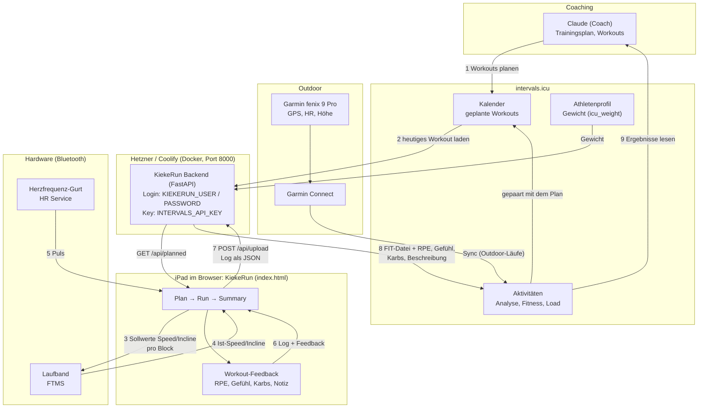
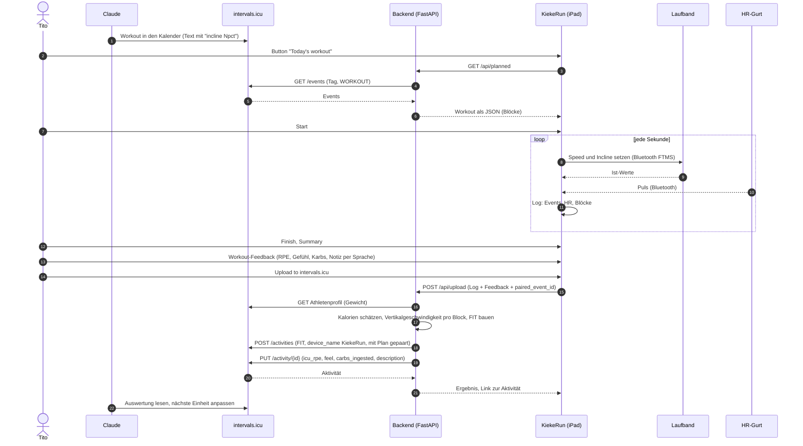

# KiekeRun: Datenfluss

Setup: Claude ist der Coach, intervals.icu der Planer und die Analyse, KiekeRun der Laufband-Runner, die Garmin fenix 9 Pro die Uhr für draußen.

## Gesamtübersicht

## Ablauf Treadmill-Einheit

## Datenquellen und was daraus wird

| Daten | Quelle | Weg | Ziel in intervals.icu |
|---|---|---|---|
| Geplantes Workout | Claude | Kalender-Event, Textformat mit `incline Npct` | Kalender (Kategorie WORKOUT, `external_id` `tcoach-…`) |
| Sollwerte Speed/Incline | Workout-Blöcke | KiekeRun sendet per Bluetooth FTMS ans Laufband | nur im Log |
| Ist-Speed, Incline, Distanz | Laufband | Bluetooth FTMS, 1 Hz | FIT: Geschwindigkeit, Distanz |
| Höhenmeter | berechnet aus Speed und Incline | Backend | FIT: Höhe, Steigung (Elevation gain) |
| Puls | HR-Gurt | Bluetooth, direkt im Browser | FIT: Herzfrequenz |
| Kalorien | berechnet (ACSM-Formel) | Backend, Gewicht aus intervals-Profil oder `BODY_WEIGHT_KG` | FIT `total_calories`, Beschreibung |
| Vertikalgeschwindigkeit pro Block | berechnet | Backend | Beschreibung der Aktivität |
| RPE | Tito | Feedback-Popup | `icu_rpe` |
| Gefühl | Tito | Feedback-Popup | `feel` |
| Kohlenhydrate | Tito | Feedback-Popup (Summe) | `carbs_ingested` |
| Notiz | Tito (Sprache) | Feedback-Popup | `description` |
| Outdoor-Lauf | Garmin fenix 9 Pro | Garmin Connect, Sync nach intervals.icu | Aktivität |

## Komponenten und Zugang

| Komponente | Aufgabe | Zugang / Geheimnisse |
|---|---|---|
| KiekeRun (`index.html`) | Runner, Bluetooth, Feedback, Log | Browser, HTTP-Basic-Login |
| Backend (`server/app.py`) | Brücke zu intervals.icu, FIT-Bau, Kalorien | `KIEKERUN_USER`, `KIEKERUN_PASSWORD`, `INTERVALS_API_KEY`, `INTERVALS_ATHLETE_ID`, optional `TZ_NAME`, `BODY_WEIGHT_KG` |
| intervals.icu API | Kalender, Aktivitäten, Profil | Basic-Auth, Benutzer `API_KEY` |
| Hosting | Docker auf Coolify (Hetzner), Port 8000 | Build-Pack Dockerfile, Deployment per GitHub-Push auf `main` |

## Hinweise

- Der Garmin-Pfad (Garmin Connect nach intervals.icu) liegt außerhalb dieses Repos und ist nur der Vollständigkeit halber eingezeichnet.
- Laufband-Einheiten werden nur über KiekeRun aufgezeichnet, nicht über die Garmin.
- Die Aktivität bleibt als `VirtualRun` angelegt. Ein Wechsel auf `Run` bräuchte einen zusätzlichen API-Aufruf.
- Läuft das Upload-Update (RPE usw.) in einen Fehler, bleibt die Aktivität trotzdem erhalten, der Fehler wird nur gemeldet.
- Doppelte Uploads erkennt intervals.icu an der `external_id` und legt keine zweite Aktivität an.
